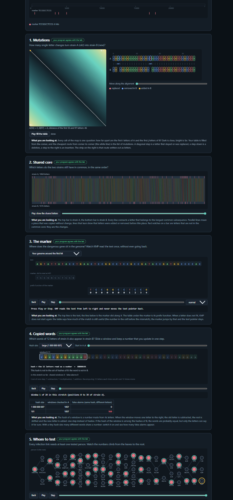

# Assignment 4. Patient Zero

Student ID: 252949
Name: Sharafitdin Alina
Group: SE-2532

This file is the report. Fill it in as you go. How to start: `START_HERE.md`. The task: `docs/Assignment4.pdf`.

## Program output

The 9 lines your program prints on your data (`java -cp out Main`):

       Mutations: 72
    Shared core: 1020
    Marker hits: 6
    First hit: 417
    Border length: 4
    Shared words: 489
    Tests needed: 36
    Cheapest testing: 160
    Longest chain: 28

My outbreak report (a screenshot of `output/outbreak.html`):

## Questions

Answer in your own words, two or three sentences each.

Mission 1. What does the cell d[i][j] of your table mean, and how is it computed from other cells?
d[i][j] stores the minimum number of changes needed to turn the first
i letters of A into the first j letters of B. I choose the minimum
between deletion, insertion and replacement; matching letters have
a replacement cost of zero. The first row and column represent
inserting or deleting all letters.

Mission 2. How is the longest common subsequence different from the longest common substring? My Shared core is bigger than the number of letters that are the same at the same place: why?
A subsequence keeps the order of letters but allows gaps, while
a substring must be continuous. Shared core can include letters
at different positions in A and B, so it can be larger than
the number of matching letters at the same positions.

Mission 3. What does the prefix function tell you, and why does the pointer in the text never go back in KMP? What is the Border length of my marker and what does it mean?
The prefix function gives the length of the longest proper prefix
that is also a suffix for each prefix of the pattern. KMP uses
this information to reuse previous matches without moving the
text pointer backwards. My Border length is 4, meaning that
the first four letters of my marker equal its last four letters.

Mission 4. Why must you compare the letters after the hashes are equal? What happens to the cost of Rabin-Karp if many windows have the same hash?
Different words can have the same hash, so I compare their letters
before counting a match. If many unequal windows have equal hashes,
the algorithm performs many extra comparisons and can become
as slow as O(|A| * |B| * k) in the worst case.

Mission 5. What are the two states of a person in your DP, and how do you get the answer for a person from its children? Why does a greedy "test the person with most links first" not always give the cheapest answer?
The two states store the minimum cost when a person is tested
and when that person is not tested. If the person is not tested,
every child must be tested; otherwise, I choose the cheaper state
for each child. Choosing the person with the most links can fail
because that person's test may cost more than testing their neighbours.

## AI use
I used ChatGPT for algorithm explanations
The syllabus requires you to say which AI tools you used and for what. Write the tool (ChatGPT, Copilot, other) and what you asked it: explain an idea, find an error, review code. Write "none" if you did not use any. If you took code or text from a book or a website, give the source here.

## Timing (Mission 7)

Milliseconds, average of 3 runs, from `java -cp out Bench`.
| test | size | time (ms) |
|---|---|---|
| naive search | 20 000 / 40 000 / 80 000 | 103.6 / 168.8 / 362.4 |
| KMP | 20 000 / 40 000 / 80 000 | 5.3 / 2.2 / 1.0 |
| edit distance | 500 / 1000 / 2000 / 4000 | 12.6 / 15.0 / 41.6 / 161.2 |

With a fixed pattern length, naive search takes approximately twice
as long when the text size doubles. KMP has linear time complexity,
but these short measurements decrease because of JVM warm-up and
measurement noise. Edit distance has quadratic time complexity:
from length 2000 to 4000, the measured time grows almost four times.

## Complexity

n is the length of the text (or of a strain), m the length of the pattern, k the length of the window, v the number of people. Fill in every algorithm you wrote.
n and m are the lengths of strains A and B.
t is the text length, p is the pattern length.
k is the window length, v is the number of people.
C is the total number of candidate pairs checked letter by letter.

| algorithm | time | space | assumptions |
|---|---|---|---|
| Edit distance | O(n * m) | O(n * m) | Full DP table |
| LCS | O(n * m) | O(n * m) | Full DP table |
| Prefix function and KMP | O(t + p) | O(p + h) | h is the number of stored hits |
| Rabin-Karp (shared words) | O(n + m + k + C * k) | O(m) | Expected O(1) HashMap operations; worst-case comparisons O(n * m * k) |
| Tree DP and longest chain | O(v) | O(v) | Input is a tree; each edge is processed a constant number of times |

## Before you submit

- The four files in `data` and the screenshot `output/outbreak.png` are in the repository.
- `java tools/Check.java` shows all examples right.
- This README is filled in, the program output and the section AI use included.
- The work is pushed to main (at least one commit per mission) and the repository is public.
- The link is attached in Moodle.
